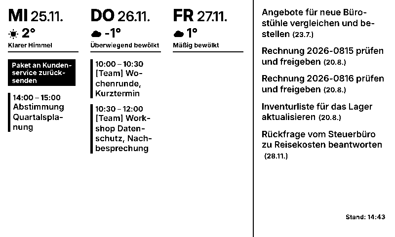

# TRMNL Eigenfirmware

Eigene Firmware für das **TRMNL OG** (ESP32-C3, 7,5″ E-Ink, 800 × 480, 1 Bit). Das Display holt Termine, Aufgaben und Wetter **selbst** und zeichnet das Bild auch selbst. Es braucht nur ein WLAN, keinen eigenen Server und kein TRMNL-Konto.



**Installieren:** [christiankriedemann.github.io/trmnl-eigenfirmware](https://christiankriedemann.github.io/trmnl-eigenfirmware/) im Browser (Chrome oder Edge) öffnen, Display per USB anschließen, „Installieren“ klicken. Nur für das TRMNL OG mit ESP32-C3.

## Was es kann

- **Kalender:** Google Workspace (Dienstkonto mit domänenweiter Delegierung) und Microsoft 365 (Anmeldung per Gerätecode am Display).
- **Aufgaben:** Todoist, Google Tasks, Microsoft Planner und To Do. Auswahl nach Fälligkeit, Deadline und Priorität mit festen Quoten je Gruppe.
- **Wetter:** Open-Meteo, ohne Schlüssel.
- **Unterwegs:** mehrere WLANs (z. B. Heimnetz und Handy-Hotspot), Standort per WLAN-Ortung (BeaconDB), Zeitzone und Wetter folgen dem Aufenthaltsort.
- **Ohne WLAN:** zeigt die letzten Daten weiter (vergangene Termine fallen raus) mit Hinweisbalken.
- **Akku:** Symbol ab 25 %, Hinweis „bitte aufladen“ ab 20 %, ab 5 % Ruhezustand bis zum Laden.
- **Updates per WLAN:** einmal am Tag, nur mit gültiger Signatur, mit automatischem Rückfall auf die vorige Version.
- **Einrichtung:** Taste 2 Sekunden halten, QR-Code scannen, Webinterface im Geräte-WLAN.
- **Überwachung (optional):** Wer Uptime Kuma betreibt, trägt im Webinterface unter „Für Fortgeschrittene“ die Adresse eines Push-Monitors ein. Das Display meldet sich dann stündlich, beim Start und bei Fehlern mit Version, Akkuspannung, WLAN-Stärke und Neustartgrund, ohne Termine oder Aufgaben. Ist Kuma nicht erreichbar, läuft alles normal weiter.
- **Neustarts:** Grund, letzte Runde davor und Akkuspannung stehen dauerhaft im Gerät (Webinterface und USB-Befehl `status`), auch nach leerem Akku.

## Bedienung

| Taste | Wirkung |
|---|---|
| kurz drücken | sofort aktualisieren (bzw. Microsoft-Anmeldung starten) |
| 2 Sekunden halten | Einrichtung: eigenes WLAN mit QR-Code, Webinterface unter 192.168.4.1 |

## Bauen

```bash
pio run                 # Firmware bauen
pio run -t upload       # per USB aufspielen (Gerät vorher per Taste wecken)
preview/run.sh          # Layout am Mac aus Beispieldaten rendern (preview/out/*.png)
```

Einstellungen lassen sich auch per USB setzen: `tools/geraet.py --reset "set schluessel wert" run` (Befehlsfenster 5 s nach Neustart; Geheimnisse über `@UMGEBUNGSVARIABLE`, sie erscheinen nie in der Ausgabe).

## Updates veröffentlichen

`tools/release.sh` baut die Firmware, signiert sie (ECDSA P-256) und legt ein GitHub-Release mit `firmware.bin` und `manifest.json` an. Das Gerät prüft die Signatur mit dem öffentlichen Schlüssel in `src/ota_key.h`. Wer eine eigene Variante verteilen will, braucht ein eigenes Schlüsselpaar und eine eigene Manifest-Adresse (`ota_url`).

## Lizenzen

- Eigener Code: GPL-3.0 (siehe `LICENSE`).
- Schrift **Inter** (Rasmus Andersson): SIL Open Font License 1.1, als Bitmaps eingebettet.
- Deutsche Trennmuster **hyph-de-1996** (tex-hyphen): MIT.
- Zeitzonentabelle **posix_tz_db** (nayarsystems): MIT.
- Bibliotheken: bb_epaper (Larry Bank), ArduinoJson (Benoît Blanchon, MIT), QRCode (Richard Moore, MIT).
- Pinbelegung des TRMNL OG aus der offenen TRMNL-Firmware (GPL-3.0).

Kein offizielles Produkt von TRMNL.
